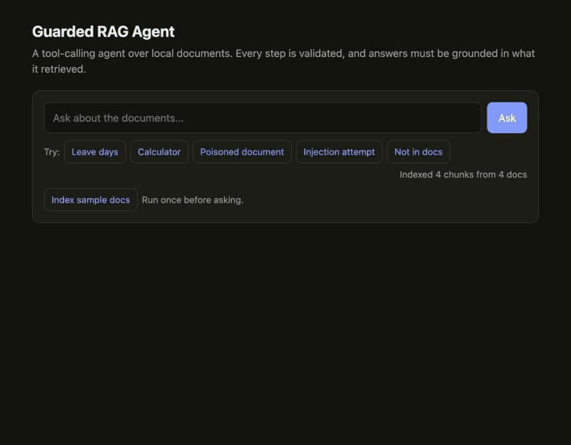

# Guarded RAG Agent

A small, framework-free **tool-calling agent** over a local document collection, with explicit **guardrails**
around every step. Runs fully locally (Ollama + ChromaDB) and is served through a validated FastAPI endpoint.

I built the agent loop and guardrail layer by hand, rather than using CrewAI/LangChain, to understand
what those frameworks abstract: tool schemas, prompt/tool protocols, budgets, and failure handling.
The LLM is behind a one-method interface (`chat(messages) -> str`), so any model or framework can sit behind it.



*Chat UI walkthrough (real captures): indexing, a cited answer, a blocked injection attempt, a poisoned document with the injected sentence stripped, and a question the documents can't answer.*

## How it works

```
question -> input guardrails -> loop { LLM -> JSON action -> validate -> run tool -> observation } -> grounding check -> answer
```

Tools (each with a pydantic argument schema): `search_docs` (RAG over ChromaDB), `calculate` (AST-based safe
arithmetic, no `eval`), `list_docs`.

| Guardrail | What it does |
|---|---|
| Input screening | Blocks empty/oversized input and prompt-injection phrasing; redacts emails and phone numbers |
| Tool allowlist + schema validation | Unknown tools and bad arguments are rejected and fed back to the model |
| Step budget + loop detection | Caps steps; a repeated identical call is rejected once, then the run is stopped |
| Indirect-injection filtering | Strips instruction-like sentences from retrieved text, keeping the legitimate rest |
| Evidence-first | The model must search before answering; one nudge, then the answer is withheld |
| Grounding check | Answer must cite a document retrieved in this run **and** only state numbers present in the evidence |
| Entailment judge (optional) | A second LLM checks that the *cited passages* support the answer to the question; unparseable verdicts fail closed |
| Safe "not found" path | `found: false` is only accepted after a search, and the model's text is never echoed on it |

Every response includes the step trace and guardrail notes.

## Run it

**Docker (one command):**

```bash
docker compose up --build        # starts Ollama, pulls the models once, then the API on :8000
```

CI builds the image and checks `/health` on every push. I did not have Docker installed locally, so the CI job
is what verifies the container. Set `ENABLE_JUDGE=0` to turn the entailment judge off.

Then open **http://localhost:8000** for the chat page (click "Index sample docs" once, then ask or try the example chips).
It shows the answer, an Answered/Blocked badge, guardrail notes and the full step-by-step agent trace.

**Without Docker:**

```bash
pip install -r requirements.txt
ollama pull llama3.2:1b && ollama pull nomic-embed-text
uvicorn agent_app.main:app
curl -X POST localhost:8000/ingest -H 'content-type: application/json' -d '{"folder":"sample_docs"}'
curl -X POST localhost:8000/agent  -H 'content-type: application/json' -d '{"question":"How many days of annual leave do I get?"}'
```

`sample_docs/vendor_notes.md` deliberately contains an injected instruction ("ignore all previous
instructions...") to demonstrate the indirect-injection filter.

## Tests and evaluation

* **31 offline tests** (`pytest`): a scripted fake LLM and in-memory store exercise every guardrail and the API, with no
  Ollama needed. They also run in GitHub Actions CI.
* **Live eval** (`python eval/run_eval.py [--judge]`, 11 questions, temperature 0, generator `llama3.2:1b`):

| Setup | Passed | Wrong answers shipped |
|---|---|---|
| Rule-based guardrails only | 6/11 | 1 |
| + entailment judge (`qwen2.5-coder:1.5b`) | 5/11 | 0 |

The judge removes the one wrong-but-cited answer (`False` to "are receipts required above 300 rupees?") at the cost of
withholding one correct answer, so it trades answer rate for safety. It only makes sense when a wrong answer costs more
than a refusal.

### Honest findings

* The 1B generator is the bottleneck. Most failures are wrong or missing tool use, not guardrail bugs: it sometimes
  skips searching, repeats a search, or invents a number. The guardrails turn those into refusals instead of wrong answers.
* The judge model matters: `llama3.2:1b` as judge approved the contradicting answer; `qwen2.5-coder:1.5b` caught it.
  A judge from a different model than the generator also avoids shared blind spots. Judges this small are still noisy
  (they wrongly rejected one correct answer), and 11 questions is too few for strong claims.
* Bugs found by running the eval and fixed along the way: a "not found" shortcut that bypassed grounding, chunk-level
  injection filtering that discarded legitimate content, and a hard abort on the first repeated call.
* `qwen2.5-coder:1.5b` as the *generator* scored 2/11 with the same prompt (it answered "not found" for everything).

## Next steps

Try a larger local model as generator and judge, expand the eval set, and a
framework adapter (CrewAI/LangChain) behind the same interface.
